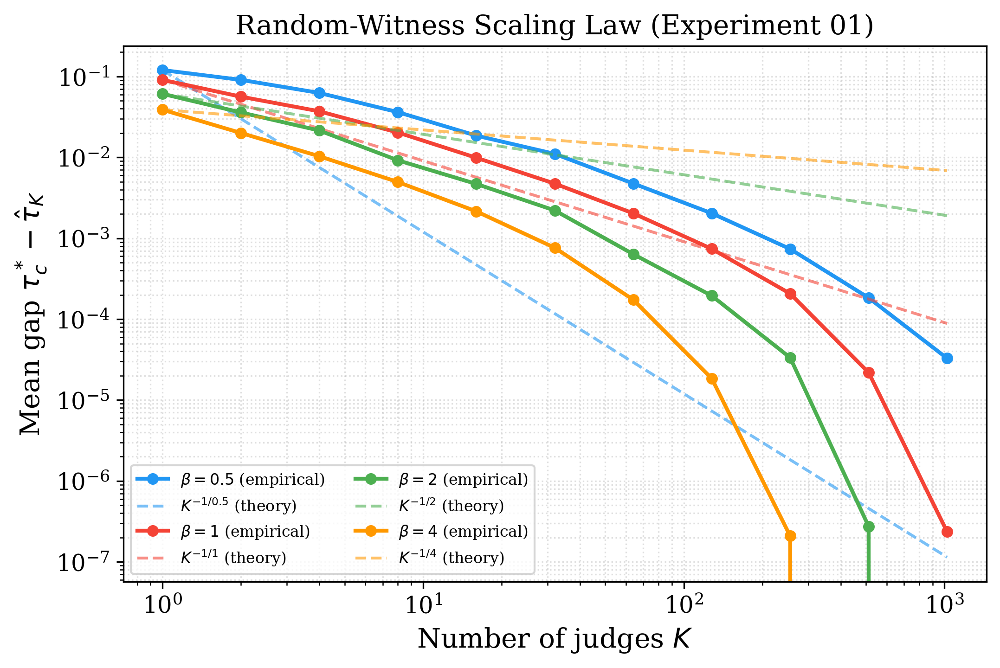

# Experiment 01 — Random-Witness Scaling Law

**Generated**: 2026-04-05 20:35:20

## TL;DR

The best-of-K gap scales as K^{-1/beta} for random-witness judges, confirming Theorem 1. Fitted exponents closely match theoretical predictions across all tested beta values.

## Configuration

| Parameter | Value |
|-----------|-------|
| d (grid size) | 20 |
| correlation | 0.5 |
| beta values | [0.5, 1, 2, 4] |
| K sweep | [1, 2, 4, 8, 16, 32, 64, 128, 256, 512, 1024] |
| N reps | 500 |
| tau_c (true TVD) | 0.182024 |
| tau_c_critic (optimal critic delta) | 0.182024 |

## Fitted Exponents

| beta | alpha_predicted (1/beta) | alpha_fitted | R^2 |
|------|--------------------------|--------------|------|
| 0.5 | 2.0000 | 0.5174 | 0.9906 |
| 1 | 1.0000 | 0.6786 | 0.9976 |
| 2 | 0.5000 | 0.7852 | 0.9975 |
| 4 | 0.2500 | 0.9445 | 0.9998 |

## Plots

- Log-log scaling: `plots/exp1_scaling_loglog.png`
  

## Raw data

- Fitted exponents CSV: `../results/exp1_fitted_exponents.csv`
