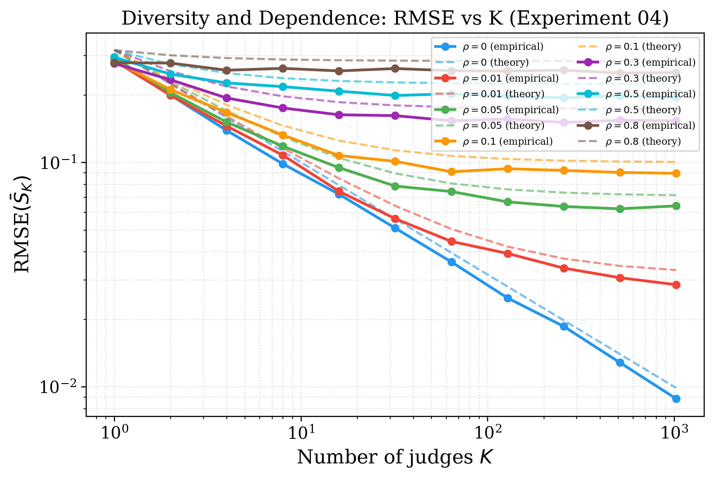
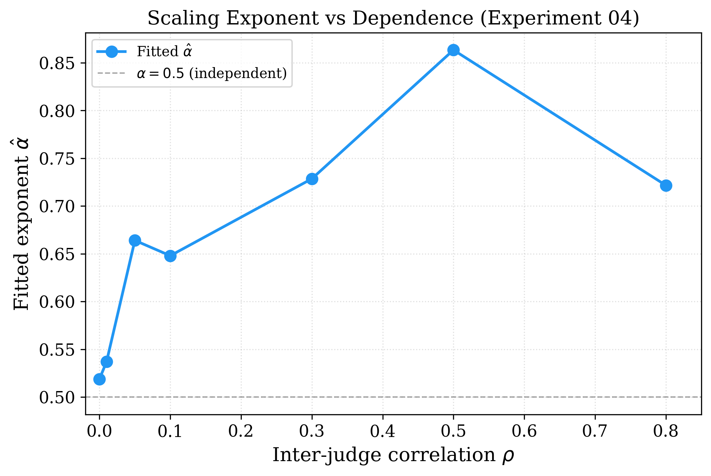

# Experiment 04 — Diversity and Dependence (rho Effect)

**Generated**: 2026-04-05 20:05:21

## TL;DR

RMSE of the ensemble mean follows the equicorrelation formula RMSE(K, rho) = sigma * sqrt((1-rho)/K + rho). When rho = 0, the scaling exponent is ~0.5 (standard 1/sqrt(K) rate). As rho increases, the RMSE curve flattens to an irreducible floor of sqrt(sigma^2 * rho), and the effective exponent degrades.

## Configuration

| Parameter | Value |
|-----------|-------|
| tau_c (true quality) | 0.5 |
| sigma^2 (variance) | 0.1 |
| sigma | 0.3162 |
| rho values | [0, 0.01, 0.05, 0.1, 0.3, 0.5, 0.8] |
| K sweep | [1, 2, 4, 8, 16, 32, 64, 128, 256, 512, 1024] |
| N reps | 1000 |

## Fitted Exponents

| rho | alpha_hat | R^2 | floor_theory |
|-----|-----------|------|--------------|
| 0 | 0.5189 | 0.9998 | 0.0000 |
| 0.01 | 0.5370 | 0.9993 | 0.0316 |
| 0.05 | 0.6640 | 0.9997 | 0.0707 |
| 0.1 | 0.6480 | 0.9973 | 0.1000 |
| 0.3 | 0.7286 | 0.9933 | 0.1732 |
| 0.5 | 0.8634 | 0.9939 | 0.2236 |
| 0.8 | 0.7217 | 0.7902 | 0.2828 |

## Plots

- RMSE vs K (log-log): `plots/exp4_rmse_vs_K.png`
  

- Exponent vs rho: `plots/exp4_exponent_vs_rho.png`
  

## Raw data

- Fitted exponents CSV: `../results/exp4_fitted_exponents.csv`
