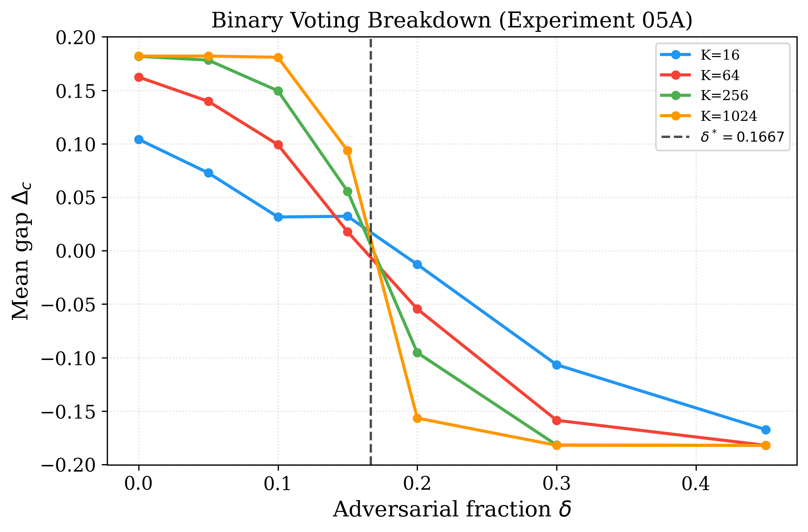
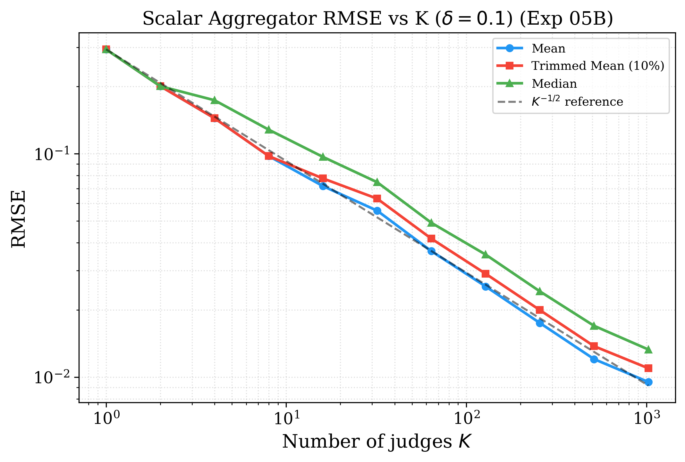
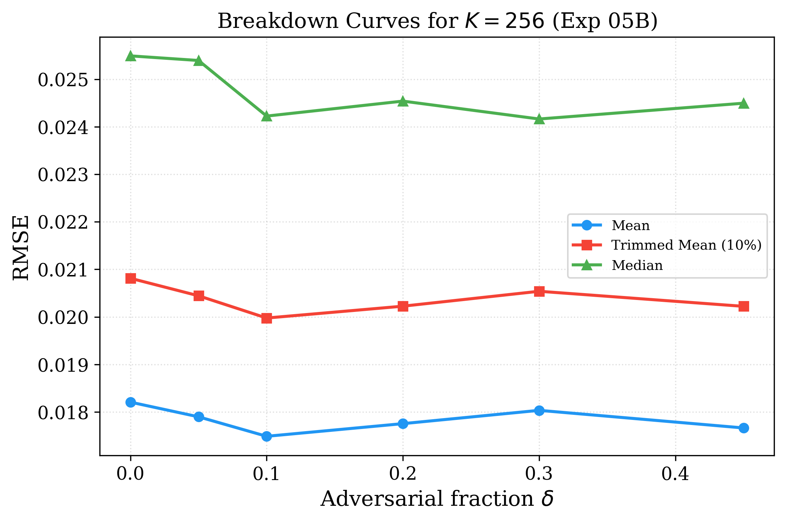

# Experiment 05 — Adversarial Robustness and Breakdown

**Generated**: 2026-04-05 20:23:15

## TL;DR

Binary voting breaks down when the adversarial fraction delta exceeds delta* = 2*gamma/(1+2*gamma) = 0.1667. Robust scalar aggregators (trimmed mean, median) maintain accuracy under moderate contamination where the simple mean fails.

## Configuration

| Parameter | Value |
|-----------|-------|
| d (grid size) | 20 |
| correlation | 0.5 |
| gamma | 0.1 |
| delta* (breakdown) | 0.1667 |
| tau_c_critic | 0.182024 |
| tau_c (scalar) | 0.5 |
| sigma^2 | 0.1 |
| N reps | 500 |

## Part A — Binary Voting Breakdown

| K | delta=0 | delta=0.05 | delta=0.1 | delta=0.15 | delta=0.2 | delta=0.3 | delta=0.45 |
|---| --- | --- | --- | --- | --- | --- | --- |
| 16 | 0.104163 | 0.072781 | 0.031540 | 0.032204 | -0.012826 | -0.106640 | -0.167247 |
| 64 | 0.162404 | 0.139696 | 0.099163 | 0.017692 | -0.054496 | -0.158607 | -0.182012 |
| 256 | 0.181789 | 0.178211 | 0.149536 | 0.055541 | -0.095320 | -0.181753 | -0.182024 |
| 1024 | 0.182024 | 0.182021 | 0.180870 | 0.093539 | -0.156560 | -0.182024 | -0.182024 |

## Part B — Scalar Aggregator RMSE (delta=0.1)

| K | Mean | Trimmed Mean | Median |
|---|------|--------------|--------|
| 1 | 0.293704 | 0.293704 | 0.293704 |
| 2 | 0.200868 | 0.200868 | 0.200868 |
| 4 | 0.144382 | 0.144382 | 0.173777 |
| 8 | 0.097730 | 0.097730 | 0.128284 |
| 16 | 0.071716 | 0.077594 | 0.096889 |
| 32 | 0.055655 | 0.063001 | 0.074633 |
| 64 | 0.036672 | 0.041704 | 0.049114 |
| 128 | 0.025493 | 0.029057 | 0.035397 |
| 256 | 0.017486 | 0.019975 | 0.024224 |
| 512 | 0.012049 | 0.013766 | 0.016981 |
| 1024 | 0.009520 | 0.010965 | 0.013306 |

## Plots

- Binary breakdown: `plots/exp5_binary_breakdown.png`
  

- Scalar aggregators: `plots/exp5_scalar_aggregators.png`
  

- Breakdown curves: `plots/exp5_breakdown_curves.png`
  

## Raw data

- Part A CSV: `../results/exp5_binary_breakdown.csv`
- Part B CSV: `../results/exp5_scalar_contamination.csv`
