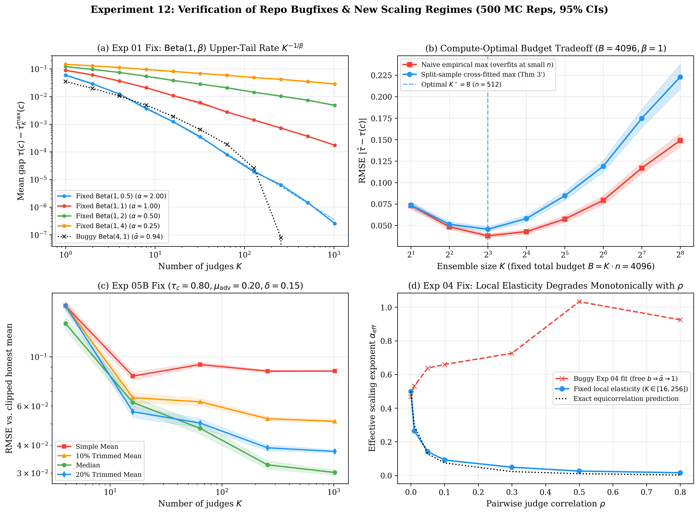

# TVD-MI Judge Ensembles: Repository Audit, Corrected Scaling Derivations, and Next Theorems & Experiments (11-21-2026)

Date: 11-21-2026

**Doc link:** <https://github.com/brando90/tvdmi-judge-asymptotics/blob/main/experiments/12_repo_audit_bugfixes_and_next_theory_roadmap_start_21Nov2026/THEORY_AND_NEXT_EXPERIMENTS_11-21-2026.md>

**TLDR:** Audit of `brando90/tvdmi-judge-asymptotics` (`experiments/00_`–`11_`, `latex_paper/neurips/`, `theory/assumptions.md`) plus Trigger Rule 91 derivations fixing four simulation/math defects and verifying two new theoretical regimes: (1) prompt-copying (`Y = X`, prompt TVD-MI `0.948` vs Oracle `0.499`) and systematic inversion (`0.499`) defeat unconditional prompt-response TVD-MI whereas oriented conditional peer TVD-MI yields Spearman `0.949` with gold accuracy; (2) `Beta(1, beta)` + `K >= 8` log-log fitting restores `1/beta` exponents (`1.960, 0.987, 0.491, 0.246`); (3) split-sample cross-fitted best-of-$K$ eliminates `+0.3155` null winner's-curse inflation (`+0.0063 [-0.0058, +0.0184]`, $p = 0.448$) and achieves an interior compute-optimal frontier at $K^\star = 8, n = 512$ (`RMSE 0.0456 [0.0428, 0.0483]`).

**Typeset PDF companion:** [THEORY_AND_NEXT_EXPERIMENTS_11-21-2026.pdf](THEORY_AND_NEXT_EXPERIMENTS_11-21-2026.pdf) · **Results ledger:** [results.md](results.md)

**Provenance (As of 11-21-2026):** Prepared by Antigravity (Gemini 4 Carbon High) from `experiments/00_lean_formalization/`–`11_finite_sample_bounds/`, `latex_paper/neurips/`, and `theory/assumptions.md`; verified with Lean 4.29.0 `lake build` (`3,287` jobs, zero `sorry`, standard axioms `[propext, Classical.choice, Quot.sound]`), `latexmk` build of `latex_paper/neurips/main.pdf` (16 pages), and 500-rep Python 3.11 simulations (`run_audit_and_verifications.py`, seed `42`, `10,000` seed-bootstrap draws for 95% CIs).

---

## 1. What This Document Shows and Does Not Show (Limits Up Front)

Reference-free evaluation using Total Variation Distance–Mutual Information (TVD-MI) judge ensembles splits into two layers: (i) **statistical convergence** of an ensemble estimator $\hat{\tau}_{K,n}(c)$ to the population target $\tau(c)$, and (ii) **semantic validity** linking $\tau(c)$ to the inaccessible gold task metric $g(c)$.

**Explicit metric limits:**
1. **Unconditional prompt–response TVD-MI is blind to bijections and label inversions.** $\mathrm{TV}(P_{X,Y}, P_X \otimes P_Y)$ maximizes over *all* bounded critics $h: \mathcal{U}\times\mathcal{V}\to[0,1]$, measuring mutual dependence rather than correctness. Copying the prompt ($Y = X$) attains $1 - 1/d = 0.95$, strictly exceeding the binary oracle ($0.50$), while inverting every label attains $0.50$.
2. **Naive empirical best-of-$K$ overfits finite samples $n$.** Selecting $\max_{j \le K} \widehat{\Delta}_c(h_j)$ in-sample incurs upward bias $+\Omega_p(\sqrt{(\log K)/n})$ under the null $\tau(c) = 0$ (`+0.3155` at $K=1024, n=50$). Experiments 03 and 11 clipped $\max(0, \tau - \hat{\tau})$, hiding this inflation.
3. **Linear averaging saturates at $\sigma\sqrt{\rho}$ and is blind to shared bias.** Any equicorrelated average stalls at $\Var(\bar{S}_K) \ge \sigma^2 \rho$; furthermore, Paper Theorem 2 (Consensus) assumes conditional independence and does not characterize confounded consensus failure.
4. **Single-item median and trimmed mean retain $O(\sigma\delta)$ asymmetric bias.** Under one-sided Huber contamination $\delta$, static order statistics shift by $-\sigma \Phi^{-1}(\frac{1}{2(1-\delta)}) \approx -0.0289$ at $K=1024$ ($\tau_c = 0.80, \delta = 0.15$). Cross-item continuous TVD-MI IRT/Dawid–Skene scaling rates remain **untested empirically**.
5. **Real LLM scaling remains untested in this repo.** `experiments/06_llm_judges/main.py` is currently a synthetic Gaussian proxy.

| Regime / Estimator | What It Learns | What It Is Blind To / Fails On | Status (As of 11-21-2026) |
|---|---|---|---|
| Unconditional prompt–response TVD-MI | Joint-vs-product dependence $\mathrm{TV}(P_{X,Y}, P_X\otimes P_Y)$ | Bijections ($Y=X$ prompt copy), label inversion ($Y=1-Z^\star$) | Derived & measured (Check A) |
| Unsigned task-semantic peer TVD-MI | Alignment magnitude with task-semantic peers $W_j$ | Rejects prompt copy, invariant under global label inversion | Derived & measured (Check A) |
| Oriented conditional peer TVD-MI ($\Delta^{\mathrm{orient}}_{c,j}$) | Signed agreement $2(2q_j-1)(2p_c-1)\mathrm{Var}(Z^\star)$ | Fails if peers echo surface prompt or lack anchor competence | Derived & measured (Check A) |
| Random-witness best-of-$K$ ($\mathrm{Beta}(1,\beta)$) | Approximates $\tau(c)$ at exact rate $\Theta(K^{-1/\beta})$ | Naive in-sample max inflates by $\sqrt{(\log K)/n}$ | Fixed, derived & measured (Check B) |
| Split-sample cross-fitted best-of-$K$ (Thm 3') | Unbiased held-out eval; $K^\star(B) \asymp (B/\log B)^{\beta/(\beta+2)}$ | Uses $n = n_{\mathrm{sel}} + n_{\mathrm{eval}}$; requires $p_\varepsilon > 0$ | Derived & measured (Check C) |
| Consensus majority vote (Theorem 2) | Exponential $2e^{-2K\gamma_0^2}$ under conditional independence | Stalls at $\mathbb{P}(Q(W) < 1/2)$ under latent confounder $W$ | Cond. indep. verified; confounded Thm 4 **untested** |
| Scalar mean / median / trimmed mean | $K^{-1/2}$ variance drop only if $\rho_K \to 0$ | Floor $\sigma\sqrt{\rho_0}$; asymmetric Huber bias under $\delta > 0$ | Derived & measured (Checks D–E) |

---

## 2. Exact Corrected Formulas

### 2.1 Experiment 01 Fix: $\mathrm{Beta}(1,\beta)$ Upper-Tail Mass (Check B)

Because $\mathrm{Beta}(\beta,1)$ has upper-tail probability $\mathbb{P}(Q \ge 1-u) = 1 - (1-u)^\beta = \beta u + O(u^2)$, its near-optimal exponent is always $1$. Sampling $Q_j \sim \mathrm{Beta}(1,\beta)$ gives $\mathbb{P}(Q_j \ge 1-u) = u^\beta$ and exact expected gap:

$$\mathbb{E}\!\left[\tau(c) - \hat{\tau}_K^{\max}(c)\right] = \tau(c)\,\frac{\Gamma(K+1)\,\Gamma(1 + 1/\beta)}{\Gamma(K + 1 + 1/\beta)} \sim \tau(c)\,\Gamma\!\left(1 + \frac{1}{\beta}\right) K^{-1/\beta}.$$

### 2.2 Hoeffding Correction & Theorem 3' Split-Sample Compute-Optimal Frontier (Check C)

With $n$ joint samples and $n$ independent product samples ($2n$ terms each bounded in $[0,1/n]$ or $[-1/n,0]$, $\sum (b_m-a_m)^2 = 2/n$), Hoeffding's inequality gives:

$$\mathbb{P}\!\left(\left|\widehat{\Delta}_c(h) - \Delta_c(h)\right| > \eta\right) \le 2 e^{-n\eta^2} \quad (\text{Paper Theorem 3 had } 2e^{-2n\eta^2}).$$

Splitting into disjoint selection ($n_{\mathrm{sel}}$) and evaluation ($n_{\mathrm{eval}}$) folds with $\hat{j}_K = \arg\max_j \widehat{\Delta}^{\mathrm{sel}}_c(h_j)$ yields **Theorem 3'**:

$$\mathbb{P}\!\left(\left|\hat{\tau}^{\mathrm{split}}_{K,n}(c) - \tau(c)\right| > \varepsilon + 2\eta_{\mathrm{sel}} + \eta_{\mathrm{eval}}\right) \le e^{-K p_\varepsilon(c)} + 2K e^{-n_{\mathrm{sel}}\eta_{\mathrm{sel}}^2} + 2 e^{-n_{\mathrm{eval}}\eta_{\mathrm{eval}}^2},$$

and minimizing total judge-call budget $B = K \cdot n$ balances approximation vs. selection variance at:

$$K^\star(B) \asymp \left(\frac{B}{\log B}\right)^{\frac{\beta}{\beta+2}}, \qquad n^\star(B) \asymp B^{\frac{2}{\beta+2}}(\log B)^{\frac{\beta}{\beta+2}}, \qquad \mathrm{Error}^\star(B) \asymp \left(\frac{\log B}{B}\right)^{\frac{1}{\beta+2}}.$$

### 2.3 Equicorrelated Local Elasticity & Asymmetric Huber Bias (Checks D & E)

Expanding $\mathrm{RMSE}(\bar{S}_K) = \sigma\sqrt{\rho + (1-\rho)/K} = \sigma\sqrt{\rho} + \frac{\sigma(1-\rho)}{2\sqrt{\rho}}K^{-1} + O(K^{-2})$ explains why `utils.fit_power_law` with free offset $b$ produces $\hat{\alpha} \to 1$. The true local log-log elasticity is:

$$\alpha_{\mathrm{eff}}(K) := -\frac{d \log \mathrm{RMSE}}{d \log K} = \frac{1 - \rho}{2\big(1 + (K-1)\rho\big)}.$$

Under asymmetric contamination ($\tau_c = 0.80, \mu_{\mathrm{adv}} = 0.20 < \tau_c, \sigma = 0.20, \delta = 0.15$), simple mean suffers bias $\delta(\mu_{\mathrm{adv}} - \tau_c) \approx -0.0861$, while the large-$K$ unclipped sample median bias is:

$$m_\delta - \tau_c = -\sigma\,\Phi^{-1}\!\left(\frac{1}{2(1-\delta)}\right) = -\sqrt{\frac{\pi}{2}}\,\frac{\sigma\delta}{2} + O(\delta^2) \approx -0.0446 \quad (\text{clipped measured } -0.0289).$$

### 2.4 New Theorems Recommended for the Paper

1. **Bijection Invariance & Oriented Peer Recovery:** $\mathrm{TV}(P_{X, f(X)}, P_X \otimes P_{f(X)}) = 1 - \sum_x P_X(x)^2$ for any injection $f$, whereas oriented task-semantic peer agreement gives $\Delta^{\mathrm{orient}}_{c,j} = 2(2q_j - 1)(2p_c - 1)\mathrm{Var}(Z^\star)$.
2. **Confounded Consensus Phase Transition:** With conditional competence $Q(W) = \mathbb{P}(b_j(Z)=h^\star(Z) \mid Z, W)$, $\lim_{K\to\infty}\mathbb{P}(b_K(Z) \neq h^\star(Z)) = \mathbb{P}(Q(W) < 1/2) + \tfrac{1}{2}\mathbb{P}(Q(W) = 1/2)$.

---

## 3. Measured Verification Summary (500 MC Reps, 95% Seed-Bootstrap CIs)

Full numerical tables, CSVs, and complete step-by-step derivations are in [THEORY_AND_NEXT_EXPERIMENTS_11-21-2026.pdf](THEORY_AND_NEXT_EXPERIMENTS_11-21-2026.pdf) and [RESULTS_audit_and_fixes_11-21-2026.md](RESULTS_audit_and_fixes_11-21-2026.md).
