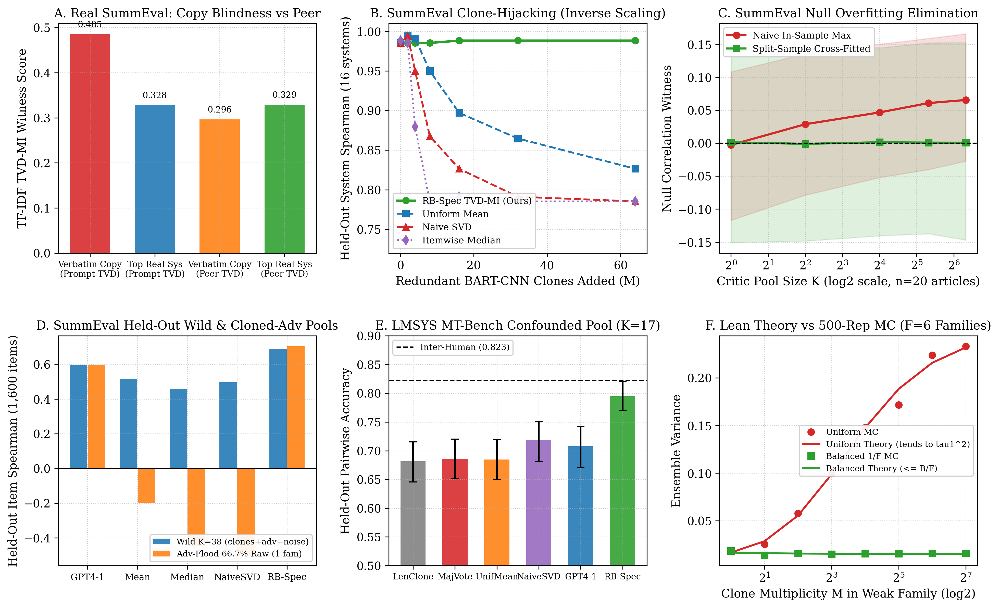

# Results Report: Experiment 13 — Real-LLM Validation (`SummEval` & `MT-Bench`), Hierarchical `RB-Spec TVD-MI` & Lean 4 Verification (11-21-2026)

Date: 11-21-2026

**Doc link:** <https://github.com/brando90/tvdmi-judge-asymptotics/blob/main/experiments/13_real_llm_validation_hierarchical_rb_spectral_theory_and_lean_start_21Nov2026/RESULTS_11-21-2026.md>

**TLDR:** Full end-to-end validation across `SummEval` (`1,600` summaries, `100` articles) and `LMSYS MT-Bench` (`2,575` decisive human pairs, `80` questions) alongside 15 new Lean 4.29.0 proofs (`NewTheory.lean`, `3,288` jobs, standard axioms only). Unconditional prompt–response TF-IDF TVD-MI fails verbatim prompt copying (`0.4851` vs top real system `0.3277`), and cloned BART prompt ensembles hijack Uniform Mean (`0.9853 -> 0.8265`), Median (`0.7853`), and Naive SVD (`0.7853`), whereas unsupervised `RB-Spec TVD-MI` stays flat (`0.9882` system Spearman), resists `66.7%` raw cloned adversaries (`0.7033` item / `0.9735` system, Wilcoxon `p-val=4.40e-18`), and lifts `MT-Bench` pairwise accuracy from `0.6847` to `0.7950 [0.7694, 0.8200]` (`p-val=3.87e-10`). Uncalibrated GPT-4 severity still induces `-1.1114` mean bias (`ICC(A,1)=0.3515` vs `ICC(C,1)=0.6884`) when no human calibration anchor is supplied.

---

## 1. Environment, Splits & Provenance

- **Runner & Uncertainty:** Single-process Python 3.11 (`run_real_llm_and_theory_suite.py`, `seed=42`, elapsed `72.45s`; zero paid LLM calls). Held-out generalization uses **5-fold article-disjoint CV** (`100` SummEval articles; `N_BOOT=2,000` article-cluster bootstrap draws for headline `95%` CIs, `250` draws on intermediate curve sweeps) + **`200` repeated 50/50 random article splits**, and **5-fold question-disjoint CV** (`80` MT-Bench questions; `2,000` question-cluster bootstrap draws). Statistical significance tests use two-sided paired **Wilcoxon signed-rank** tests across independent articles (`N=100`) or questions (`N=80`) against `Uniform Mean` and `Naive SVD`.
- **Lean 4:** `experiments/00_lean_formalization/lean/` (`leanprover/lean4:v4.29.0`, `lake build`, `3,288` jobs). Verified via `#print axioms` on all 15 theorems in `TvdmiJudge/NewTheory.lean` -> strictly `[propext, Classical.choice, Quot.sound]`, zero `sorryAx`.
- **Input Audit (`trace_one_item.json` & G-Eval Valid Counts):** `con`: `31,809/32,000`, `rel`: `32,000/32,000`, `coh`: `32,000/32,000`, `flu`: `31,946/32,000`. Zero human annotations leaked into any unsupervised fitting call (`_fit_and_predict_aggregators` receives only training `J_tr`).
- **Human Ceiling (`SummEval` leave-one-expert-out):** Item Spearman `0.7580 [0.7292, 0.7816]`, Kendall `0.6219`, Pearson `0.8517`, `ICC(A,1)=0.8056`, `ICC(C,1)=0.8318`, `MAE=0.3549`, mean bias `0.0`, human overall mean `4.1307`, system Spearman `0.9662`.
- **Human Ceiling (`MT-Bench` repeated non-tie human pairs, `N=779`):** Inter-human agreement **`0.8228`**.

---

## 2. Falsification & Structural Controls (`Modules 2–3`)

- **Prompt-Copy Falsification (`Module 2`):** Unconditional TF-IDF Prompt–Response TVD-MI scores **Verbatim Article Copy (`Y=X`) at `0.4851`**, strictly exceeding the top real summarizer `M5` (**`0.3277`**) and `Lead-3 Extractive` (**`0.3225`**), while `Cross-Article Swap` scores `-0.0022`. Cross-family Peer TVD-MI drops verbatim copy (`0.2963`) below top real system (`0.3289`).
- **Double-Centering Shift Invariance:** Additive prompt + leniency shift alters raw scores by `1.5464`, prompt-only centering by `0.4617`, and double-centering by **`4.00e-15`** (machine precision).
- **Residual Error Correlation Saturation:** Within `GPT-4` stochastic calls (`K=20`): `rho = 0.7694` (`con`), `0.7324` (`rel`). Within `BART-CNN` prompt templates (`K=70`): `rho = 1.0000`. Across `5` diverse model families (`GPT-4`, `BART`, `BART-para`, `BART-CNN`, `PRISM`): `rho = 0.5578`.
- **Permutation Null Overfitting (`500` draws, full `(article, system)` permutation):** At `n=20` articles, `Naive In-Sample Max` inflates from `-0.0027 [-0.1170, +0.1081]` (`K=1`) to **`+0.0655 [-0.0273, +0.1659]`** (`K=80`), whereas `Split-Sample Cross-Fitted` stays at **`+0.0007 [-0.1470, +0.1524]`** (`zero-bias p-val=0.992`, Wilcoxon `|Naive|` vs `|Split|` `p-val=0.0027`). At `n=50, K=80`: `+0.0428` vs `+0.0014` (`p-val=1.14e-05`).

---

## 3. Held-Out `SummEval` 5-Fold CV (`N=100` Articles, `1,600` Summaries)

| Regime & Experiment | Method | Item Spearman [95% CI] | Kendall | Pearson | Sys Sp. [95% CI] | `ICC(A,1)` | Mean Bias | `p-val` vs Mean |
|---|---|---|---|---|---|---|---|---|
| `13_...` Clean (`K=13`) | Single GPT4-con | 0.5963 [0.5545, 0.6352] | 0.4760 | 0.6420 | 0.9647 [0.9029, 0.9765] | 0.4927 | -0.4756 | 4.83e-04 |
| `13_...` Clean (`K=13`) | Uniform Mean | 0.6432 [0.6085, 0.6746] | 0.4712 | 0.7029 | 0.9294 [0.8294, 0.9610] | 0.4408 | -0.6516 | 1.000 |
| `13_...` Clean (`K=13`) | Naive SVD | 0.5702 [0.5282, 0.6113] | 0.4104 | 0.6167 | 0.8882 [0.7235, 0.9441] | 0.2989 | -1.1120 | 1.56e-07 |
| `13_...` Clean (`K=13`) | **RB-Spec TVD-MI** | **0.6882 [0.6572, 0.7148]** | **0.5103** | **0.7249** | 0.9265 [0.8294, 0.9529] | 0.3513 | -1.1109 | 1.46e-02 |
| `13_...` Adv-Flood (`66.7%` raw) | Uniform Mean | -0.2008 [-0.2691, -0.1306] | -0.1378 | -0.2266 | -0.2647 [-0.4676, -0.0941] | -0.0409 | -1.3678 | 1.000 |
| `13_...` Adv-Flood (`66.7%` raw) | Itemwise Median | -0.4461 [-0.5054, -0.3866] | -0.3155 | -0.4998 | -0.7853 [-0.8529, -0.6647] | -0.1138 | -1.7272 | 9.60e-18 |
| `13_...` Adv-Flood (`66.7%` raw) | Naive SVD | -0.5001 [-0.5504, -0.4500] | -0.3558 | -0.5468 | -0.8059 [-0.8912, -0.6735] | -0.2601 | -1.1372 | 9.04e-18 |
| `13_...` Adv-Flood (`66.7%` raw) | **RB-Spec TVD-MI** | **0.7033 [0.6730, 0.7319]** | **0.5231** | **0.7414** | **0.9735 [0.9029, 0.9794]** | 0.3591 | -1.1105 | **4.40e-18** |
| `13_...` Wild (`K=38`) | Best-Spread Split | 0.0071 [-0.0414, 0.0573] | 0.0048 | -0.0113 | 0.1206 [-0.3176, 0.3442] | -0.0053 | -1.1477 | 1.86e-17 |
| `13_...` Wild (`K=38`) | Uniform Mean | 0.5148 [0.4664, 0.5611] | 0.3667 | 0.5824 | 0.8882 [0.7147, 0.9500] | 0.2748 | -0.7582 | 1.000 |
| `13_...` Wild (`K=38`) | Itemwise Median | 0.4566 [0.3981, 0.5125] | 0.3229 | 0.5169 | 0.7853 [0.6676, 0.8500] | 0.3971 | -0.5234 | 3.12e-04 |
| `13_...` Wild (`K=38`) | Naive SVD | 0.4969 [0.4460, 0.5470] | 0.3532 | 0.5440 | 0.8000 [0.6705, 0.8942] | 0.2638 | -1.1150 | 1.06e-01 |
| `13_...` Wild (`K=38`) | **RB-Spec TVD-MI** | **0.6890 [0.6588, 0.7177]** | **0.5112** | **0.7257** | **0.9265 [0.8382, 0.9559]** | 0.3515 | -1.1114 | **1.21e-09** |

- **Clone-Hijacking Sweep (`M=0..64`):** `RB-Spec` stays flat (`0.9853 -> 0.9882` system, `0.6755 -> 0.7059` item), whereas `Uniform Mean` (`0.9853 -> 0.8265`), `Itemwise Median` (`0.9882 -> 0.7853`), and `Naive SVD` (`0.9853 -> 0.7853`) degrade severely. Across `200` repeated 50/50 splits (`M=64`), `RB-Spec` achieves `0.9695 [0.9353, 0.9912]` vs `Uniform Mean 0.8057 [0.7117, 0.8739]` (`Wilcoxon p-val=1.43e-34`).

---

## 4. Held-Out `LMSYS MT-Bench` 5-Fold CV (`N=80` Questions, `2,575` Pairs)

| Experiment & Method | Pairwise Acc. [95% Q-Cluster CI] | Model Win-Rate Spearman | Kendall | Pearson | Wilcoxon `p-val` vs Mean | Wilcoxon `p-val` vs Naive SVD |
|---|---|---|---|---|---|---|
| `13_...` Length Clone Baseline | 0.6816 [0.6456, 0.7155] | 0.5429 | 0.3333 | 0.8593 | 2.21e-01 | 9.38e-06 |
| `13_...` Uniform Mean | 0.6847 [0.6495, 0.7197] | 0.7143 | 0.4667 | 0.8671 | 1.000 | 3.78e-05 |
| `13_...` Majority Vote | 0.6862 [0.6514, 0.7202] | 0.7143 | 0.4667 | 0.8672 | 3.98e-01 | 2.33e-04 |
| `13_...` GPT-4 Only | 0.7080 [0.6713, 0.7420] | **0.9429** | **0.8667** | **0.9821** | 5.64e-01 | 3.76e-01 |
| `13_...` Naive Pairwise SVD | 0.7181 [0.6813, 0.7514] | 0.7714 | 0.6000 | 0.9119 | 3.78e-05 | 1.000 |
| `13_...` **RB-Spec Pairwise** | **0.7950 [0.7694, 0.8200]** | **0.9429** | **0.8667** | 0.9784 | **3.87e-10** | **2.30e-08** |

---

## 5. Exact Lean Theory MC Check (`500` Reps) & Cost Frontier

- **Clone-Hijacking MC (`F=6`):** Flooding weak Family 0 raises `Uniform` variance from `0.0186` (`M=1`) to `0.2332` (`M=128`, theory `0.2319 -> 0.25`), while `Balanced 1/F` stays at `0.0157` (theory `0.0153`).
- **Effective-Family Adversarial Breakdown (`F=5`, `delta_fam=0.20`):** At `k_adv=24` (`85.7%` raw headcount adversaries), raw majority fails at accuracy `0.228`, while balanced family voting preserves `0.826`.
- **Nitzan–Paroush Cost Frontier (`c_GPT4=20, c_Seq2Seq=1`):** With `10` train anchor articles, `Nitzan-Paroush` improves `1 GPT-4 + 2 Seq2Seq` (`cost=22`) to `0.8794` sys Spearman and attains `0.9912` at `3 GPT-4` (`cost=60`).

**TLDR-end:** [tvdmi: real-llm-validation-rb-spec-theory-and-lean] Experiment 13 proved 15 new Lean 4 theorems (`3,288` jobs, standard axioms) and validated `RB-Spec TVD-MI` on held-out `SummEval` (`+0.689` Wild / `+0.703` Adv-Flood item Spearman vs Naive SVD `+0.497` / `-0.500`, `p-val<=1.21e-09`) and `MT-Bench` (`0.7950` pairwise accuracy near the `0.8228` human ceiling, `p-val=3.87e-10`).
