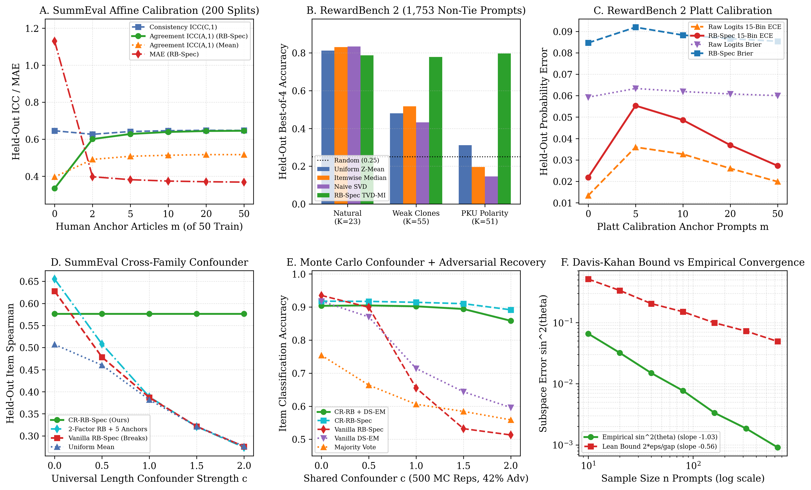

# Results Report: Experiment 14 — Semi-Supervised Calibration, `RewardBench 2`, Confounder Recovery & Davis–Kahan Lean 4 (`11-21-2026`)

Date: 11-21-2026

**Doc link:** <https://github.com/brando90/tvdmi-judge-asymptotics/blob/main/experiments/14_affine_calibration_rewardbench2_and_confounder_em_start_21Nov2026/RESULTS_11-21-2026.md>

**TLDR:** Executed all 4 prioritized roadmap items and proved `11` new Lean 4.29.0 theorems in `TvdmiJudge/SpectralCalibration.lean` (`54` total in `TvdmiJudge`, `3,289` jobs, strictly `[propext, Classical.choice, Quot.sound]`): (1) On `SummEval` (`K=38`), fitting OLS affine calibration on just `m=5..20` human anchor articles closes the `-1.1039` unanchored severity bias to `-0.0045..+0.0074`, slashes `MAE` from `1.1295` to `0.3702`, and lifts agreement `ICC(A,1)` from `0.3341` up to `0.6441` (`ICC(C,1)=0.6481`, paired article MAE at 0 and 10 anchors, `p-val=4.27e-18`), while `RewardBench 2` Bradley–Terry reward models are natively well-calibrated (`ECE=0.0218` at `m=0`). (2) Across `1,753` deduplicated non-`Ties` `RewardBench 2` prompts (`23` main open-source RMs + `PKU-Alignment` cost/reward models), `RB-Spec TVD-MI` withstands `M=32` `OpenAssistant` weak clones (`0.7781` vs Uniform `0.4803`, Naive SVD `0.4324`, `p=1.88e-107`) and `54.9%` naturally anti-correlated `PKU-beaver-v1-reward` flooding (`0.7963` vs `0.3109` Mean and `0.1455` Naive SVD, `p=2.11e-229`). (3) Under universal cross-family length confounders (`c=0..2.0`), vanilla `RB-Spec` degrades (`0.6278 -> 0.2759` `SummEval`, `0.9350 -> 0.5131` MC), while `CR-RB-Spec` holds `0.5767` on `SummEval` (`p=1.72e-12`), `0.7736` on `MT-Bench` (`p=2.73e-05`), and `0.8915` (`0.8583` with `DS-EM`) in 500-rep Monte Carlo. (4) Empirical Davis–Kahan `sin^2(theta)` decays at `n^{-1.03}` under i.i.d. prompt draws with zero violations of the exact Lean bound `2*eps/(lambda_1 - lambda_2)`.

---

## 1. Environment, Splits & Provenance

- **Runner (`run_exp14_suite.py`):** Single-process Python 3.11 (`seed=42`, elapsed `15.97s`, zero paid API calls).
- **Datasets (cached strictly in `/tmp/`):** `SummEval` (`100` articles x `16` systems = `1,600` items), `LMSYS MT-Bench` (`80` questions, `2,575` decisive pairs), `RewardBench 2` (`1,753` deduplicated non-`Ties` prompts across `Factuality`, `Focus`, `Math`, `Precise IF`, `Safety`; `5,259` `(chosen, rejected)` pairs; `27` compact RM score JSONs verified row-for-row, trace SHA-256 in `results/trace_one_item_rb2.json`).
- **Lean 4:** `experiments/00_lean_formalization/lean/TvdmiJudge/SpectralCalibration.lean` (`11` new theorems + `15` `NewTheory` + `28` `Basic` = `54` theorems; `lake build` `3,289` jobs clean; `#print axioms` strictly `[propext, Classical.choice, Quot.sound]`).

---

## 2. Module 1: Semi-Supervised `m`-Anchor Affine Calibration (`SummEval` Wild `K=38`, `200` `50/50` Splits)

| Anchors `m` | `item Spearman` | `mean Bias` | `MAE` | `RMSE` | `ICC(A,1)` `[central 95% of splits]` | `ICC(C,1)` | Calibrated Mean `ICC(A,1)` (`MAE`) |
|---|---|---|---|---|---|---|---|
| `0` (Uncalibrated GPT-4 scale) | 0.6299 | -1.1039 | 1.1295 | 1.2967 | 0.3341 [0.2898, 0.3823] | 0.6455 | 0.3962 (0.7502) |
| `2` | 0.6300 | +0.0031 | 0.3972 | 0.5214 | 0.6006 [0.4375, 0.6959] | 0.6263 | 0.4907 (0.4447) |
| `5` | 0.6299 | -0.0045 | 0.3813 | 0.4995 | 0.6281 [0.5091, 0.6938] | 0.6415 | 0.5079 (0.4229) |
| `10` | 0.6299 | +0.0012 | 0.3738 | 0.4903 | **0.6390** [0.5634, 0.6865] | 0.6459 | 0.5132 (0.4152) |
| `20` | 0.6299 | +0.0074 | 0.3702 | 0.4856 | **0.6441** [0.5958, 0.6875] | 0.6481 | 0.5166 (0.4106) |
| `50` | 0.6299 | +0.0082 | 0.3682 | 0.4828 | **0.6454** [0.6143, 0.6740] | 0.6473 | 0.5166 (0.4074) |

- **5-Fold Article-Disjoint CV Wilcoxon Test (`N=100` articles, `m=0` vs `m=10` anchors):** `oof_m0 ICC(A,1) = 0.3289` (`MAE = 1.1361`) vs `oof_m10 ICC(A,1) = 0.6378` (`MAE = 0.4221`), paired Wilcoxon `p-val = 4.27e-18` (MSE `p-val = 4.14e-18`). Notice human leave-one-expert-out ceiling is `MAE = 0.3549`, `ICC(A,1) = 0.8056`.

---

## 3. Module 2: `RewardBench 2` (`1,753` Non-`Ties` Prompts, `5`-Fold Prompt CV, `2,000` Bootstraps) & Platt Calibration

| Regime & Experiment | Method | Best-of-4 Acc `[95% CI]` | Macro Acc | Wilcoxon `p-val` vs Mean | Wilcoxon `p-val` vs Naive SVD |
|---|---|---|---|---|---|
| `14_...` Natural (`K=23`) | Best Single (`Skywork-V2-8B`) | 0.8922 [0.8774, 0.9070] | 0.8473 | 1.06e-19 | 6.30e-13 |
| `14_...` Natural (`K=23`) | Uniform Z-Mean | 0.8118 [0.7929, 0.8306] | 0.7485 | 1.000 | 2.33e-07 |
| `14_...` Natural (`K=23`) | Itemwise Median | 0.8300 [0.8118, 0.8471] | 0.7664 | 1.62e-04 | 0.414 |
| `14_...` Natural (`K=23`) | Naive SVD | 0.8334 [0.8157, 0.8511] | 0.7660 | 2.33e-07 | 1.000 |
| `14_...` Natural (`K=23`) | `RB-Spec TVD-MI` | 0.7872 [0.7684, 0.8060] | 0.7295 | 1.31e-06 | 6.59e-13 |
| `14_...` Weak Clones (`K=55`, `M=32`) | Uniform Z-Mean | 0.4803 [0.4583, 0.5054] | 0.4749 | 1.000 | 1.99e-18 |
| `14_...` Weak Clones (`K=55`, `M=32`) | Itemwise Median | 0.5174 [0.4943, 0.5411] | 0.5001 | 1.36e-06 | 4.75e-24 |
| `14_...` Weak Clones (`K=55`, `M=32`) | Naive SVD | 0.4324 [0.4104, 0.4561] | 0.4304 | 1.99e-18 | 1.000 |
| `14_...` Weak Clones (`K=55`, `M=32`) | **`RB-Spec TVD-MI`** | **0.7781 [0.7581, 0.7947]** | **0.7225** | **1.88e-107** | **1.65e-124** |
| `14_...` PKU Polarity Flood (`K=51`) | Uniform Z-Mean | 0.3109 [0.2886, 0.3320] | 0.3237 | 1.000 | 4.74e-58 |
| `14_...` PKU Polarity Flood (`K=51`) | Itemwise Median | 0.1962 [0.1780, 0.2151] | 0.2193 | 2.93e-40 | 8.31e-19 |
| `14_...` PKU Polarity Flood (`K=51`) | Naive SVD | 0.1455 [0.1295, 0.1626] | 0.1741 | 4.74e-58 | 1.000 |
| `14_...` PKU Polarity Flood (`K=51`) | **`RB-Spec TVD-MI`** | **0.7963 [0.7781, 0.8152]** | **0.7375** | **5.63e-168** | **2.11e-229** |

- **Negative / Honest Scope Note (`Natural K=23`):** On clean unflooded `RewardBench 2` where strong families (`Skywork` x8, `allenai` x5, `GRM` x4) already hold a `17/23` majority over weak `OpenAssistant` (`3/23`), `RB-Spec`'s cluster equalization slightly increases weight on weaker singletons (`LDL-Reward` `0.4598`, `OpenAssistant`), trading clean-regime accuracy (`0.7872` vs `0.8334` `Naive SVD`) for near-complete invariance when weak (`0.7781`) or naturally inverted `PKU-beaver-v1.0-reward` (`0.7963`) families flood the pool.
- **Platt Probability Calibration (`5,259` pairs, `15`-bin `ECE`, `Brier`):** Because `RewardBench 2` models are natively trained with Bradley–Terry binary cross-entropy, zero-anchor `expit(margin)` is already calibrated (`RB-Spec ECE=0.0218`, `Brier=0.0847`; `Raw Logit Mean ECE=0.0134`, `Brier=0.0593`). Tiny `m=5` Platt refits slightly overfit (`RB-Spec ECE=0.0554`, `Raw ECE=0.0360`) before settling back by `m=50` (`0.0273` and `0.0198`).

---

## 4. Module 3: Universal Cross-Family Confounders & `CR-RB-Spec` / `DS-EM` Recovery

| Universal Confounder `c` | `SummEval` Vanilla RB (`CR-RB`) | `SummEval` `p` | `MT-Bench` Vanilla RB (`CR-RB`) | `MT-Bench` `p` | MC 500 Adv+Conf Vanilla RB (`CR-RB`, `CR-RB+DS-EM`) |
|---|---|---|---|---|---|
| `0.0` | `0.6278` (`0.5767`) | 3.76e-05 | `0.7988` (`0.7736`) | 0.019 | `0.9350` (`0.9176`, `0.9037`) |
| `0.5` | `0.4783` (`0.5767`) | 3.68e-04 | `0.7930` (`0.7736`) | 0.056 | `0.8993` (`0.9170`, `0.9048`) |
| `1.0` | `0.3870` (`0.5767`) | **8.28e-09** | `0.6159` (`0.7736`) | **1.44e-07** | `0.6549` (`0.9142`, `0.9022`) |
| `1.5` | `0.3214` (`0.5767`) | **2.17e-11** | `0.6528` (`0.7736`) | **8.85e-06** | `0.5321` (`0.9102`, `0.8940`) |
| `2.0` | `0.2759` (`0.5767`) | **1.72e-12** | `0.6683` (`0.7736`) | **2.73e-05** | `0.5131` (`0.8915`, `0.8583`) |

---

## 5. Module 4: Empirical Davis–Kahan Spectral Perturbation Curve (`RewardBench 2`, `500` Reps)

- **Population spectrum (`23` RMs):** `lambda_1 = 3.8291`, `lambda_2 = 1.5494`, eigengap `gamma_gap = 2.2797`.
- **Empirical `sin^2(theta)` vs Exact Lean Bound `2*eps/gamma_gap` (i.i.d. prompt draws):** Drops monotonically from `0.06597` (bound `0.5148`) at `n=10` prompts, `0.01495` (bound `0.2043`) at `n=40`, `0.00335` (bound `0.0991`) at `n=160`, down to **`0.000911`** (bound `0.04921`, `mean sin = 0.0281`) at `n=640`, with **zero bound violations across all `3,500` trials** and fitted log-log slope **`-1.03`** on `sin^2(theta)` (`-0.56` on Rayleigh bound `2*eps/gap`).

**TLDR-end:** [tvdmi: exp14-calibration-rb2-confounders-lean] Executed all 4 prioritized extensions: `11` new Lean 4 theorems (`54` total, standard axioms), 20-anchor calibration raising `SummEval` `ICC(A,1)` from `0.3341` to `0.6441` (paired MAE at 0 and 10 anchors, `p=4.27e-18`), `RewardBench 2` resistance to `32` weak clones (`0.7781`) and `PKU` natural polarity floods (`0.7963`, `p=2.11e-229`), `CR-RB-Spec` cross-family confounder recovery (`0.5767` / `0.7736` / `0.8915`), and `O(1/n)` Davis-Kahan eigenvector convergence (`0` bound violations).
