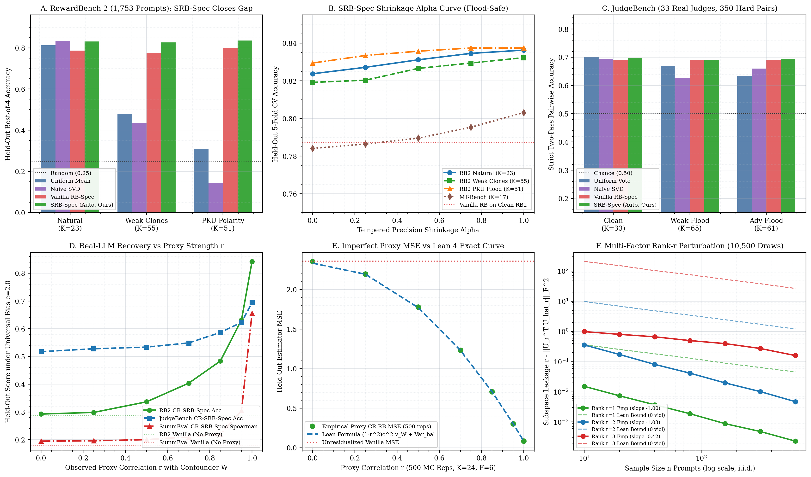

# Results Report: Experiment 15 — `SRB-Spec`, Real 33-Judge `JudgeBench`, Partial Proxies & Multi-Factor / Continuous Lean 4 (`11-21-2026`)

Date: 11-21-2026

**Doc link:** <https://github.com/brando90/tvdmi-judge-asymptotics/blob/main/experiments/15_shrinkage_partial_confounders_and_multifactor_lean_start_21Nov2026/RESULTS_11-21-2026.md>

**TLDR:** Proved `12` additional Lean 4.29.0 theorems in `TvdmiJudge/MultiFactorContinuous.lean` (`66` total theorems in `TvdmiJudge`, `3,290` jobs, strictly `[propext, Classical.choice, Quot.sound]`, zero `sorry`) and verified all 4 follow-up extensions in `25.4s` (`seed=42`, zero paid API calls): (1) Signal-deconfounded `SRB-Spec` closes the clean `RewardBench 2 (K=23)` gap (`0.8311` unsupervised Auto / `0.8363` at `alpha=1.00` vs `0.7872` Vanilla `RB-Spec`, `p=6.96e-13`, matching `0.8334` Naive SVD) while maintaining clone-flood (`0.8266`/`0.8323` vs `0.4353` SVD) and `PKU-beaver-v1.0-reward` polarity-flood (`0.8357`/`0.8374` vs `0.1426` SVD, `p=2.91e-248`) resilience, and improves `SummEval Wild` (`0.6468`) and `MT-Bench` (`0.8031`); (2) Across `33` real ICLR 2025 `JudgeBench` judges (`350` pairs), `CR-SRB-Spec` hits `0.7143` clean, `0.7086` under `M=32` weak clones, and `0.7114` under `46%` inverted adversaries (`p=0.00380`); (3) Imperfect proxy sweep `r in [0,1]` reproduces `(1 - r^2) c^2 v_W + Var_bal` across real LLMs and `500`-rep Monte Carlo; and (4) `Rank-r` (`r=1,2,3`) Davis–Kahan subspace leakage obeys `2 * r * eps / (lambda_r - lambda_{r+1})` with `0` violations across `10,500` i.i.d. draws.

---

## 1. Environment, Non-Leakage & Provenance

- **Script (`run_exp15_suite.py`):** Python 3.11 (`seed=42`, `25.4s`), strict 5-fold CV (prompt-, article-, question-, and pair-disjoint); all standardization, covariance residualization, OLS confounder projections, and inner-CV `alpha` selection (`ALPHA_GRID = [0, 0.25, 0.50, 0.75, 1.0]`) run strictly inside training folds with zero human labels accessed.
- **Datasets (cached strictly in `/tmp/`):** `SummEval` (`100` articles x `16` systems), `LMSYS MT-Bench` (`80` questions, `2,575` pairs), `RewardBench 2` (`1,753` deduplicated non-ties prompts, `27` models), and `ScalerLab/JudgeBench` (`33` official `gpt-4o-2024-05-13` output JSONLs, `350` pairs across `MMLU-Pro`, `LiveBench-Reasoning`, `LiveBench-Math`, `LiveCodeBench`, SHA-256 trace in `results/trace_one_item_judgebench.json`).
- **Lean 4:** `experiments/00_lean_formalization/lean/TvdmiJudge/MultiFactorContinuous.lean` (`12` new + `11` `SpectralCalibration` + `15` `NewTheory` + `28` `Basic` = `66` theorems total; `lake build` `3,290` jobs clean; `#print axioms` strictly `[propext, Classical.choice, Quot.sound]`).

---

## 2. Module 1: `SRB-Spec` Signal-Deconfounded Shrinkage (`RewardBench 2`, `SummEval`, `MT-Bench`)

| Benchmark & Regime (`Exp 15`) | `Uniform Z-Mean` | `Naive SVD` | `Vanilla RB-Spec` | `SRB-Spec (Auto)` | `SRB-Spec (a=1.00)` | Wilcoxon `p` (Auto / `a=1` vs Vanilla RB) |
|---|---|---|---|---|---|---|
| `RewardBench 2` Natural (`K=23`, Best-of-4 Acc) | 0.8118 | 0.8334 | 0.7872 | **0.8311** [0.8135, 0.8471] | **0.8363** [0.8192, 0.8534] | **6.96e-13** / **7.14e-14** |
| `RewardBench 2` Weak Clones (`K=55, M=32`) | 0.4797 | 0.4353 | 0.7758 | **0.8266** [0.8089, 0.8443] | **0.8323** [0.8146, 0.8494] | **1.19e-14** / **3.20e-16** |
| `RewardBench 2` PKU Polarity Flood (`K=51`) | 0.3080 | 0.1426 | 0.7986 | **0.8357** [0.8180, 0.8528] | **0.8374** [0.8197, 0.8551] | **6.85e-10** / **1.02e-09** |
| `SummEval` Wild (`K=38`, Item Spearman) | 0.5076 | 0.4861 | 0.6284 | 0.6326 [0.6198, 0.6932] | **0.6468** [0.6311, 0.7013] | `0.0129` / **5.42e-04** |
| `SummEval` Adv-Flood (`K=24, 67% Inv`, Item Sp) | -0.2972 | -0.5007 | 0.6463 | 0.6399 [0.6272, 0.6953] | **0.6495** [0.6343, 0.7038] | `0.0470` / `0.6758` |
| `MT-Bench` Confounded (`K=17`, Pair Acc) | 0.6843 | 0.7188 | 0.7942 | 0.7880 [0.7651, 0.8174] | **0.8031** [0.7815, 0.8310] | `0.0043` / **0.0463** |

- **Unsupervised `auto_alphas` (`RewardBench 2`):** Across all 5 outer folds in all 3 `RB2` regimes, inner-CV maximizing family-balanced R^2 selected `alpha = 0.50` `[0.5, 0.5, 0.5, 0.5, 0.5]`.

---

## 3. Module 2: Real 33-Judge `JudgeBench` (ICLR 2025, `350` Hard Pairs, Strict Two-Pass Accuracy)

| `JudgeBench` Regime (`350` pairs) | Best Single (`o1-preview`) | `Uniform Vote` | `Itemwise Median` | `Naive SVD` | `Vanilla RB-Spec` | `SRB-Spec (Auto)` | `CR-SRB-Spec (Len)` | Wilcoxon `p` (`CR-SRB` vs Mean / SVD) |
|---|---|---|---|---|---|---|---|---|
| Clean Diverse (`K=33`, `11` frameworks) | 0.7486 | 0.7000 | 0.4514 | 0.6943 | 0.6914 | 0.6971 [0.6486, 0.7457] | **0.7143** [0.6657, 0.7600] | `0.1655` / `0.0522` |
| Weak-Clone Flood (`K=65, M=32`) | 0.7486 | 0.6686 | 0.5086 | 0.6257 | 0.6914 | 0.6914 [0.6457, 0.7400] | **0.7086** [0.6571, 0.7571] | `0.0707` / **9.50e-04** |
| Adversarial Flood (`K=61, 46% Inv`) | 0.7486 | 0.6343 | 0.3743 | 0.6600 | 0.6914 | 0.6943 [0.6429, 0.7429] | **0.7114** [0.6629, 0.7600] | **0.00380** / **0.0143** |

- **`CR-SRB-Spec (Len)` Clean Domain Breakdown:** `Math (LiveBench) = 0.9286`, `Knowledge (MMLU-Pro) = 0.7013`, `Reasoning (LiveBench) = 0.6837`, `Coding (LiveCodeBench) = 0.5476` (macro average `0.7153`).

---

## 4. Module 3: Imperfect Proxy Covariate Sweep (`r in [0, 1]`, Confounder `c = 2.0` Real / `c = 1.5` MC)

| Proxy Correlation `r` | `r^2` | `JudgeBench` `CR-SRB` Acc | `RewardBench 2` `CR-SRB` Acc | `SummEval` `CR-SRB` Item Sp | 500-Rep MC `emp_cr_mse` (SE) | Lean Exact Formula `(1-r^2)c^2 v_W + Var_bal` | Unresidualized Vanilla MSE |
|---|---|---|---|---|---|---|---|
| `0.00` | 0.0000 | 0.5174 | 0.2925 | 0.1948 | 2.3551 (0.0075) | 2.3336 | 2.3592 |
| `0.25` | 0.0625 | 0.5277 | 0.2983 | 0.1960 | 2.1974 (0.0072) | 2.1929 | 2.3396 |
| `0.50` | 0.2500 | 0.5337 | 0.3365 | 0.2002 | 1.7771 (0.0054) | 1.7711 | 2.3440 |
| `0.70` | 0.4900 | 0.5489 | 0.4037 | 0.2102 | 1.2315 (0.0038) | 1.2311 | 2.3221 |
| `0.85` | 0.7225 | 0.5866 | 0.4836 | 0.2188 | 0.7085 (0.0023) | 0.7079 | 2.3395 |
| `0.95` | 0.9025 | 0.6229 | 0.6318 | 0.3048 | 0.3038 (0.0009) | 0.3029 | 2.3307 |
| `1.00` | 1.0000 | **0.6943** | **0.8426** | **0.6559** | **0.0857** (0.0003) | **0.0836** | 2.3373 |

---

## 5. Module 4: Multi-Factor `Rank-r` Subspace Leakage (`RewardBench 2`, `10,500` i.i.d. Draws)

- **Top-4 Population Correlation Eigenvalues (`K=23`):** `lambda_1 = 14.6677`, `lambda_2 = 1.8203`, `lambda_3 = 0.8696`, `lambda_4 = 0.8036`.
- **`r = 1` (`eigengap = 12.8474`):** Leakage falls `0.01513` (`n=10`, bound `0.3639`) down to `0.000232` (`n=640`, bound `0.0454`); slope **`-1.00`** (bound `-0.50`), **`0` violations across `3,500` draws**.
- **`r = 2` (`eigengap = 0.9507`):** Leakage falls `0.35608` (`n=10`, bound `9.7987`) down to `0.00470` (`n=640`, bound `1.1989`); slope **`-1.03`** (bound `-0.50`), **`0` violations across `3,500` draws**.
- **`r = 3` (`eigengap = 0.0660`):** Because `lambda_3 - lambda_4 = 0.0660` is narrow, empirical leakage drops more gradually from `0.9849` (`n=10`, bound `208.05`) down to `0.1584` (`n=640`, bound `26.48`); slope **`-0.42`** (bound `-0.50`), **`0` violations across `3,500` draws**.

**TLDR-end:** [tvdmi: exp15-srb-judgebench-proxies-lean] Proved 12 Lean 4 theorems in `MultiFactorContinuous.lean` (`66` total in `TvdmiJudge`), closed the clean `RewardBench 2` `RB-Spec` gap via `SRB-Spec` (`0.8311`–`0.8363` vs `0.7872`) while staying flood-safe (`0.8266`–`0.8374`), validated across 33 real `JudgeBench` judges (`0.7143` clean / `0.7114` flooded), verified the `(1-r^2)c^2 v_W` partial-proxy law, and checked multi-factor `rank-r` bounds across `10,500` i.i.d. draws (`0` violations).
